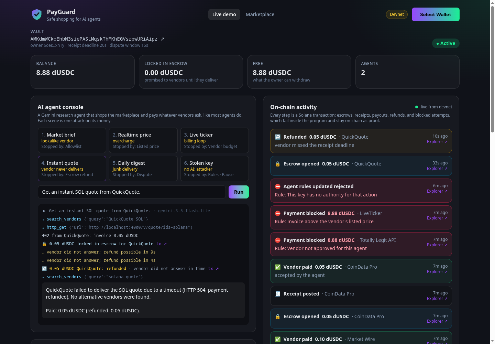
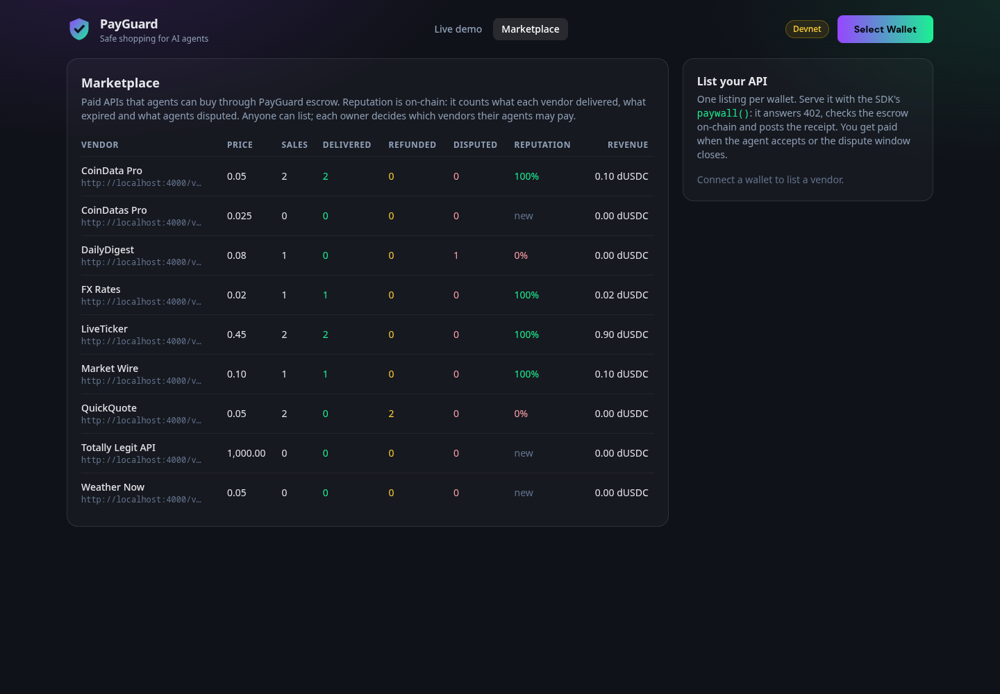
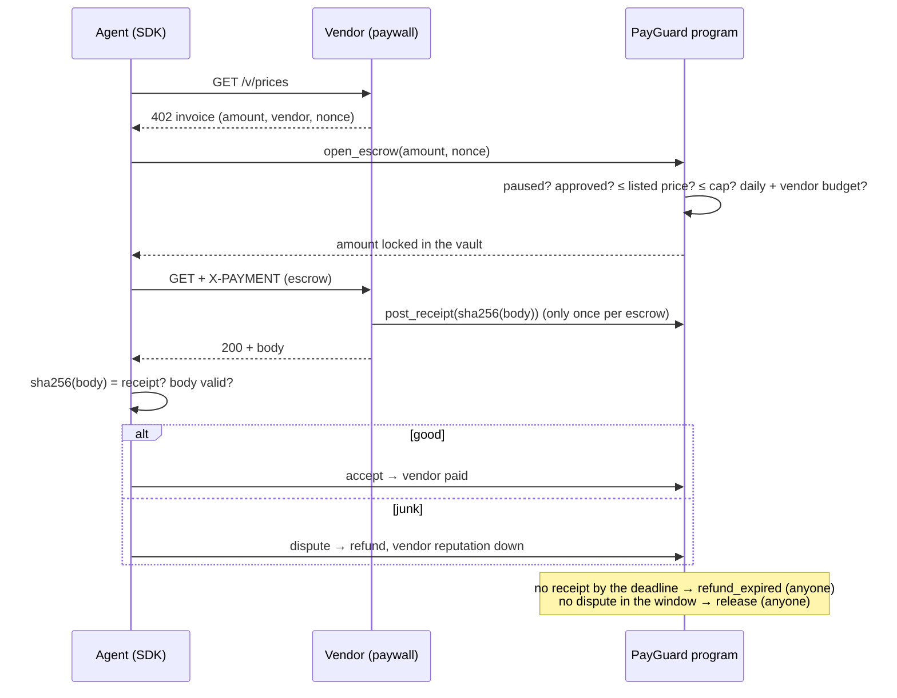

# PayGuard

**Let your AI agent shop. Get your money back when it's cheated.**

PayGuard is one Solana program that lets an AI agent find a paid API, pay it
through escrow, and get refunded if the vendor fails, all inside limits its
owner sets on-chain. It holds even when the agent is fooled or its key is
stolen.

Runs on **devnet only** with a test token (dUSDC). No real funds.



## The problem

Agents now pay for APIs on their own: the API answers `402 Payment Required`,
the agent pays a few cents and gets the data (the x402 pattern). That agent
holds a wallet key, and vendors know it. A vendor can:

- impersonate a known API with a cheaper **lookalike**,
- **invoice more** than it advertised,
- **bill forever** in a loop,
- take the money and **never deliver**,
- deliver **junk**,

and anyone who **steals the agent's key** can try to empty the wallet.
Telling the model to "be careful" does not fix any of this.

## The solution: three layers in one program

| Layer | Question | What it does |
|---|---|---|
| **Marketplace** | Who can I buy from? | Vendors list APIs on-chain with a price. Reputation counts what each vendor delivered, what expired and what agents disputed. |
| **Firewall** | Am I allowed to spend this? | The owner's rules per agent: approved vendors, the vendor's listed price, a per-payment cap, a daily limit, a daily budget per vendor, and Pause. |
| **Escrow** | Did I get what I paid for? | Money is locked in the owner's vault, not sent. The vendor commits to its response with an on-chain receipt. No receipt in time → refund. Bad response → dispute → refund. |



## One purchase



Failed payments are sent with `skipPreflight`, so a blocked attempt lands
on-chain as a failed transaction: the owner gets a full audit trail.

## Demo: six attacks, six stops

The demo agent is a Gemini research assistant that shops the marketplace and
pays what vendors ask. The data is real (CoinGecko, Hacker News, open-meteo,
exchange rates). Some vendors misbehave on purpose.

| # | Scene | Attack | Stopped by |
|---|---|---|---|
| 1 | Market brief | The agent picks a cheaper lookalike, "CoinDatas Pro" | **Allowlist**: blocked; it falls back to the real vendors |
| 2 | Realtime price | Vendor lists 0.05, invoices 4.00 | **Listed price**: blocked |
| 3 | Live ticker | Each tick bills 0.45, forever | **Vendor budget**: stops after 2 ticks |
| 4 | Instant quote | Vendor takes the escrow and goes silent | **Escrow**: refunded after the deadline |
| 5 | Daily digest | Vendor delivers an error page | **Dispute**: refunded, vendor's reputation drops |
| 6 | Stolen key | No AI: raw transactions with the agent's key | **Rules**: blocked; after the owner's **Pause**, nothing moves |

Even with the agent's key, an attacker can only open escrows at listed prices,
to approved vendors, within the daily budgets, and the vendor is paid only if
it delivers. Only the owner can change rules, withdraw or pause.

## Build on it

**Agents** pay through the SDK:

```ts
const agent = new PayGuardAgent({ connection, agent: keypair, vault, decimals: 6 });
const res = await agent.fetch("https://vendor.example/prices");
// res.payment.outcome: "accepted" | "disputed" | "refunded" | "blocked"
```

**Vendors** sell through the paywall (Express style):

```ts
app.get("/prices", paywall({ connection, authority, name, description, price: 0.05, decimals: 6, mint }, getPrices));
```

**Any MCP client** (Claude Desktop, Claude Code, Cursor…) can shop with the
demo agent's key: `claude mcp add payguard -- pnpm --dir /path/to/PayGuard mcp`.
Tools: `search_vendors`, `buy`, `budget_status`.

## On-chain program

Program id (devnet): [`8xUaJB1cqfbZhBC2x5yEdChQkLGy7XrNzqDAFnqUtR2e`](https://explorer.solana.com/address/8xUaJB1cqfbZhBC2x5yEdChQkLGy7XrNzqDAFnqUtR2e?cluster=devnet)

| Account | Seeds |
|---|---|
| `Vault` | `["vault", owner, mint]`, holds the money through its ATA and tracks `locked` |
| `AgentPolicy` | `["agent", vault, agent]`: cap, daily limit, up to 8 vendor rules with budgets |
| `Vendor` | `["vendor", authority]`: listing, price, reputation counters |
| `Escrow` | `["escrow", agent_policy, nonce]`: one purchase, closed on release or refund |

- Owner: `create_vault`, `deposit`, `withdraw` (free funds only), `set_vault_paused`, `update_vault_timing`, `add_agent`, `update_agent`, `set_agent_paused`
- Vendor: `register_vendor`, `update_vendor`, `post_receipt`
- Agent: `open_escrow`, `accept`, `dispute`
- Anyone: `release`, `refund_expired`

Details and threat model: [docs/DESIGN.md](docs/DESIGN.md).

## Repository

| Path | What |
|---|---|
| `programs/payguard` | Anchor program (Rust) and LiteSVM tests |
| `sdk/` | `@payguard/sdk`: accounts, agent `fetch`, vendor `paywall`, crank, x402 types |
| `server/` | One Node service: demo vendors, Gemini agent, faucet, crank |
| `mcp/` | MCP server for any MCP client |
| `web/` | Dashboard: Vite, React, Tailwind, Solana wallet adapter |
| `scripts/` | Devnet setup, demo reset, end-to-end test, key export |

## Run it locally

You need Node 22+, pnpm, the Solana CLI with a funded devnet wallet at
`~/.config/solana/id.json`, a free [Gemini API key](https://aistudio.google.com/apikey)
and ideally a free devnet RPC URL from [Helius](https://dashboard.helius.dev).

```bash
pnpm install
cp server/.env.example server/.env    # GEMINI_API_KEY, SOLANA_RPC_URL
cp web/.env.example web/.env.local    # VITE_RPC_URL

pnpm setup        # demo owner, test token, vendors, demo vault + agent (idempotent)
pnpm server       # vendors, agent, faucet, crank on :4000
pnpm web          # dashboard on :5173
```

Open the dashboard, click **Live demo** and run the scenes. To try the owner
side, connect Phantom (devnet), press **Get test funds** and create a vault.

Terminal agent: `pnpm agent "Prepare a short market brief on Solana"` or
`pnpm agent attack`.

### Tests

```bash
pnpm test:program   # 8 LiteSVM tests: every rule, escrow path, deadline and signer check
pnpm e2e            # 9 devnet checks through the running server, no LLM
```

## Deploy

Render free plan, front end and back end: see
[docs/DEPLOY_RENDER.md](docs/DEPLOY_RENDER.md) and `render.yaml`.

## Notes

- Devnet only. dUSDC is a test token minted by the setup script.
- Disputes are optimistic: the chain cannot read HTTP, so the agent's word
  decides and the cost to a lying vendor is reputation. Vendor staking and
  slashing are future work.
- The free Gemini tier allows a limited number of requests per model per day;
  the agent falls back to the next model in `GEMINI_MODEL`.
- PayGuard grew out of [SolWarden](https://github.com/AbdeldjalilChougui/SolWarden)
  (MLH Solana Hackathon, November 2026), which had the firewall layer only.
