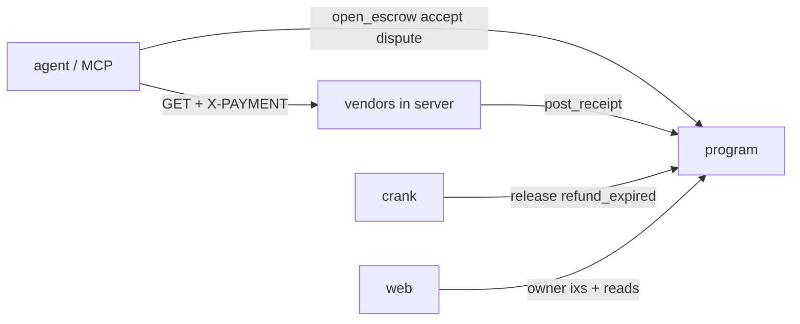

---
tags:
  - memory
  - architecture
  - payguard
last_updated: 2026-11-09
---

# Architecture

Agent GETs a vendor URL → 402 invoice (scheme `payguard-escrow`, nonce) → `open_escrow` locks the amount in the owner's vault after every rule check → agent retries with X-PAYMENT → vendor checks the escrow, posts `post_receipt(sha256(body))`, returns the body → agent compares hash and validates → `accept` or `dispute`. Missed receipt deadline → `refund_expired`; closed dispute window → `release`; both permissionless, run by the crank in [[server]].

- Entry points: `pnpm server` (:4000), `pnpm web`, `pnpm agent`, `pnpm mcp`
- State: devnet only; `payguard.config.json` (public keys) is committed and copied to web
- External: Helius devnet RPC, Gemini, CoinGecko, HN Algolia, open-meteo, er-api

Back to [[index]]
